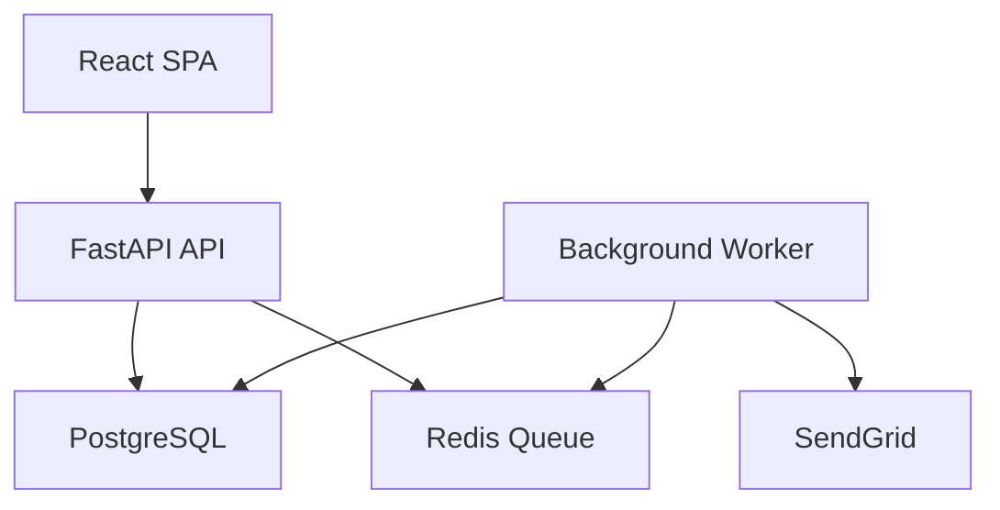
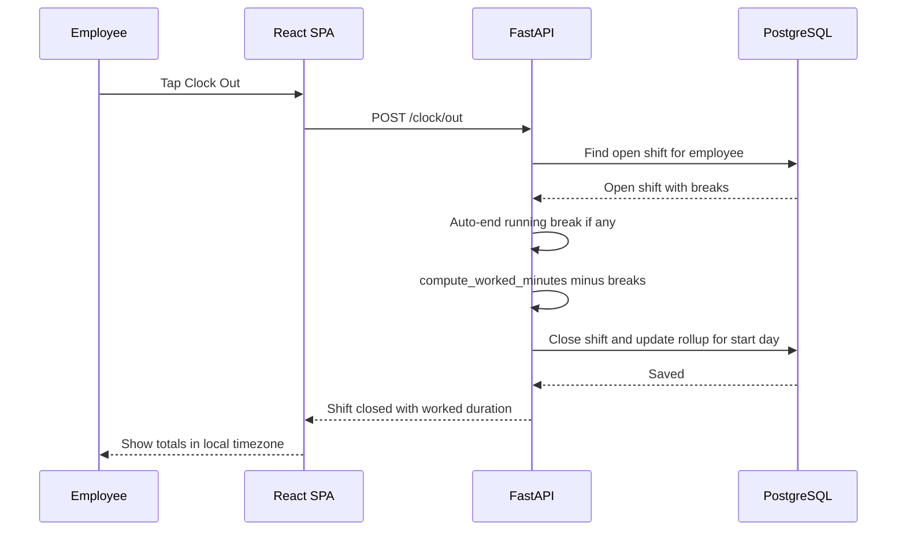
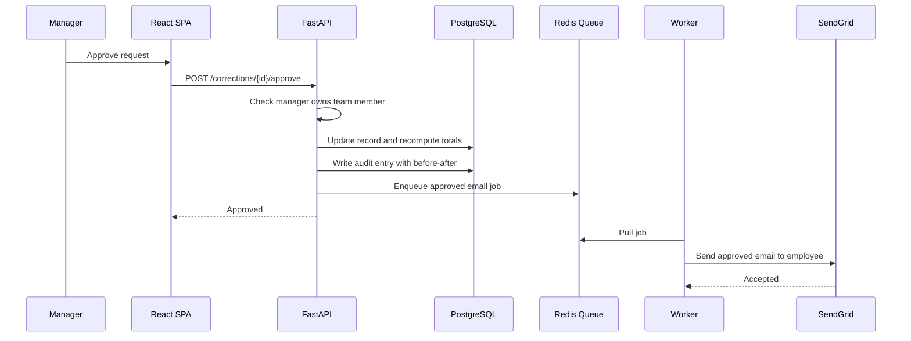
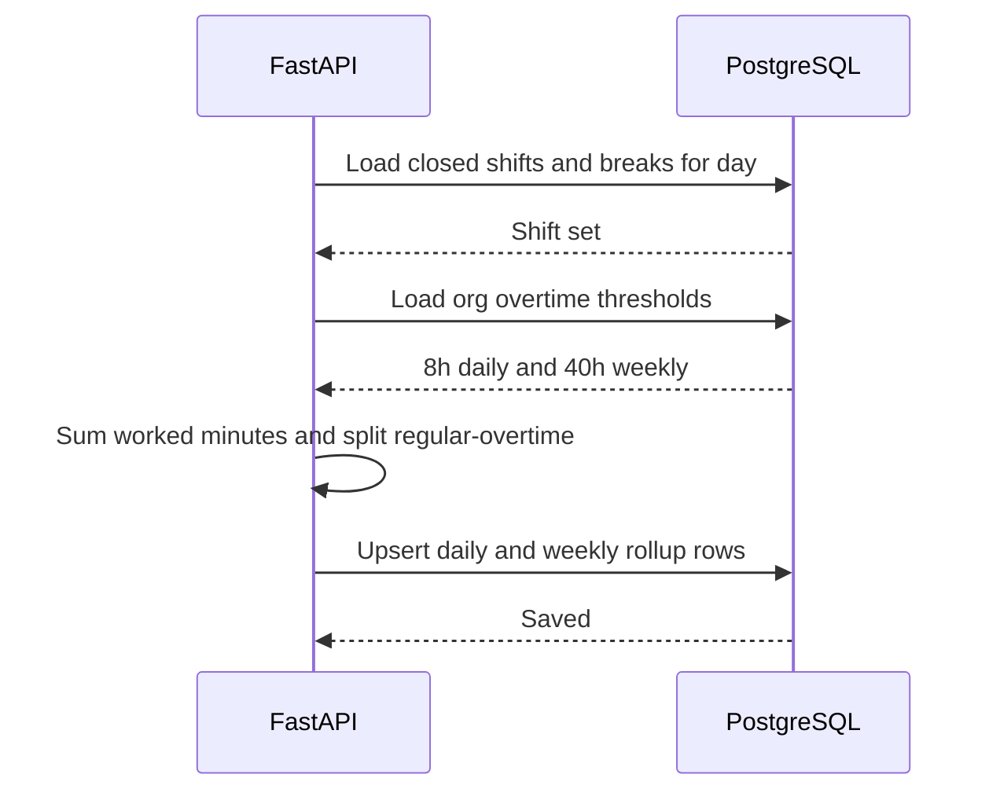
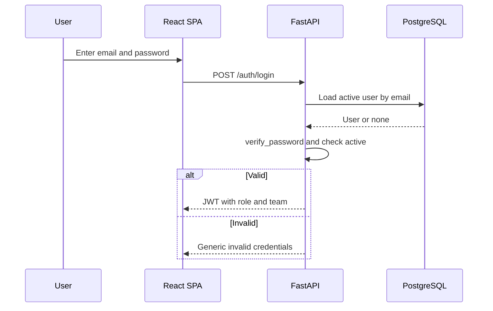
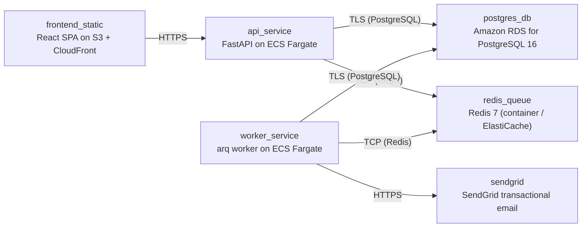

# Architecture

> Maintained by QuorQ AI SDLC. Text between `sdlc:auto` markers is regenerated; anything outside them is yours and is kept.

<!-- sdlc:auto:start narrative -->
## Overview

### ARCH-001 · approved · source: architecture:overview

Architecture v1 (status: generated) implements the exact approved stack across 6 components, 8 data entities, 25 endpoints, and 6 AWS deployment nodes, covering all 10 requirement epics.

Components: web_frontend (React 19 SPA — all screens, local-timezone display, privacy notice); api_backend (FastAPI 0.115 — auth/JWT, RBAC, clock/break state machine, rollups, correction workflow, audit log, CSV export, GDPR operations, enqueues jobs); worker (arq worker, Python — sends correction/reset emails via SendGrid, runs scheduled missing-clock-out reminder check); database (PostgreSQL 16 — employees, teams, shifts, breaks, correction_requests, org_settings, password_reset_tokens, daily_rollups, audit_log; encrypted at rest); queue (Redis 7 — job queue and scheduler); email_service (SendGrid SaaS — transactional email).
Entities: teams, employees, shifts, breaks, daily_rollups, correction_requests, org_settings, password_reset_tokens, audit_log — as fully enumerated in the architecture input with timezone-aware timestamps.
Endpoints (25 total) grouped by area: auth (/auth/login, /auth/me, /auth/password-reset/request, /auth/password-reset/confirm, /auth/privacy-notice/ack); clock (/clock/in, /clock/out, /clock/break/start, /clock/break/stop); personal (/me/dashboard, /me/hours); team (/team/records, /team/flags, /team/corrections); corrections (/corrections [POST/GET], /corrections/{id}/approve, /corrections/{id}/reject); admin (/employees [POST/PATCH/DELETE], /records/{shift_id}, /settings [GET/PATCH]); export (/export/timesheet.csv); privacy (/privacy/{employee_id}/export, /privacy/{employee_id} DELETE); audit (/audit-log).
Deployment nodes (AWS): frontend_static (React SPA on S3 + CloudFront); api_service (FastAPI on ECS Fargate, Python 3.12/uvicorn); worker_service (arq worker on ECS Fargate); postgres_db (Amazon RDS PostgreSQL 16); redis_queue (Redis 7, container/ElastiCache); sendgrid (SaaS API).
Technology decisions documented with alternatives considered: FastAPI over Django REST Framework/Flask, PostgreSQL over MySQL/SQLite, React 19 over Next.js/Vue, AWS over Azure/GCP — all matching the product-owner-approved stack with no substitutions, consistent with the requirements phase input.

**Related:** REQ-TECH-STACK, EPIC-001, EPIC-002, EPIC-003, EPIC-004, EPIC-005, EPIC-006, EPIC-007, EPIC-008, EPIC-009, EPIC-010

- ⚠ No observability/monitoring, log-retention, or backup/DR specifics are stated beyond 'encrypted at rest' and 'standard availability'.
- ⚠ No API authentication token (JWT) expiry/refresh duration is specified.

### ARCH-002 · approved · source: architecture:critical_path:clock_in_out_overnight_attribution

Describes the clock-in/out and break state machine, including blocking overlapping shifts and attributing overnight shifts to their start day.

Employee clocks in, creating an open shift (a second overlapping shift is blocked at the API level). Employee may optionally start/stop breaks during the open shift. On clock-out, any running break is auto-ended. Worked duration = clock-out minus clock-in minus unpaid breaks. The shift's work_date (and therefore its attribution for daily/weekly rollups) is set from the clock-in timestamp in the employee's configured timezone, even if clock-out occurs after midnight — directly implementing AC-012 and AC-016.

**Related:** EPIC-002, US-004, US-005, US-006, AC-009, AC-010, AC-011, AC-012, AC-013, AC-014, AC-015, AC-016

### ARCH-003 · approved · source: architecture:critical_path:correction_request_approval

Describes the correction-request submit/approve/reject flow and how it stays instant while still auditing and emailing.

Employee submits a correction with proposed times and a reason; it is saved pending and a manager-notification email is enqueued (not sent synchronously). A manager may approve or reject, scoped to their own team only. Approval updates the affected record and recomputes totals; rejection leaves the record unchanged and records the reason. Both actions write an audit_log entry and enqueue the employee-notification email via the Redis queue/worker so the approval/rejection request itself returns instantly (ties to NFR-012).

**Related:** EPIC-006, US-013, US-014, AC-030, AC-031, AC-032, AC-033

### ARCH-004 · approved · source: architecture:critical_path:daily_weekly_rollup_overtime

Describes when and how daily/weekly rollups and the regular/overtime split are computed and recomputed.

On shift close or record edit, daily totals are summed (worked minus unpaid breaks) and split into regular vs overtime against org-wide thresholds (default 8h/day). Weekly totals sum the daily totals and apply the weekly threshold (default 40h). Changing org_settings thresholds triggers an org-wide recomputation of rollups, consistent with AC-021 and AC-044.

**Related:** EPIC-003, US-007, US-008, AC-017, AC-018, AC-019, AC-020, AC-021

- ⚠ Architecture does not clarify whether daily-overtime hours are excluded from the weekly regular total before the 40h weekly threshold is applied (same double-counting ambiguity inherited from requirements, not resolved at the architecture level).

### ARCH-005 · approved · source: architecture:critical_path:authentication_rbac

Describes how sign-in, JWT-based role/team claims, and per-request data filtering enforce role-based access, plus the password-reset token flow.

Admin-provisioned accounts sign in with email and password; failed attempts return a generic message (no field disclosure). On success, a JWT carrying role and team is issued. Every data request is filtered server-side by role: employees see only their own data, managers see their team plus themselves, HR/Admin see the whole organisation. Password reset issues a time-limited, single-use token (password_reset_tokens table) and the reset email is sent via the background queue so the request path stays fast.

**Related:** EPIC-001, US-001, US-002, US-003, AC-001, AC-002, AC-003, AC-004, AC-005, AC-006, AC-007, AC-008

- ⚠ JWT expiry/refresh strategy is not specified in the architecture input.
<!-- sdlc:auto:end narrative -->

<!-- sdlc:auto:start building-blocks -->
## Building Block View

| ID | Name | Technology | Responsibility | Depends on |
|---|---|---|---|---|
| web_frontend | React SPA | React 19 | Responsive single-page web app for all screens (sign-in, clock controls, personal hours, team oversight, correction workflow, admin settings, CSV export trigger). Shows local-timezone timestamps and privacy notice at first sign-in. | api_backend |
| api_backend | FastAPI API | FastAPI 0.115 | Core server-side logic: authentication and JWT issuance, role-based access control, clock-in/out and break state machine, worked-duration and daily/weekly rollups with regular/overtime split, overnight-shift attribution, correction workflow, audit logging, CSV export, and GDPR subject-rights operations. Enqueues background jobs. | database, queue |
| worker | Background Worker | arq worker (Python) | Consumes queued jobs to send correction and password-reset emails via SendGrid, and runs the scheduled missing-clock-out reminder check, keeping clock-in and approval requests instant. | database, queue, email_service |
| database | PostgreSQL | PostgreSQL 16 | Stores employees, teams, shifts, breaks, correction requests, org settings, password-reset tokens, rollups and the audit log with timezone-aware timestamps; enforces relationships and runs date arithmetic. Encrypted at rest. | — |
| queue | Redis Queue | Redis 7 | Lightweight job queue and timed scheduler backing background email delivery and missing-clock-out reminders. | — |
| email_service | SendGrid | SendGrid (SaaS) | Transactional email delivery for correction submitted/approved/rejected, password-reset links and optional missing-clock-out reminders. | — |

<!-- sdlc:auto:end building-blocks -->

<!-- sdlc:auto:start runtime -->
## Runtime View

### Clock in/out with overnight attribution

Employee clocks in creating an open shift (second overlapping shift blocked), optionally takes breaks, then clocks out. Any running break is auto-ended. Worked duration = clock-out minus clock-in minus unpaid breaks. The shift is attributed to the work_date of its start in the employee's timezone even if it ends after midnight.

- **Components:** web_frontend, api_backend, database
- **Modules:** clock_service, shift_repository, break_repository, rollup_service
- **Key functions:** clock_in(employee_id), clock_out(employee_id), start_break(shift_id), stop_break(shift_id), attribute_work_date(clock_in_at, tz), compute_worked_minutes(shift)

### Correction request approval

Employee submits a correction with proposed times and reason (saved pending, manager emailed). Manager approves or rejects on their team only. Approval updates the record and recomputes totals, rejection leaves it unchanged with a reason. Both write an audit entry and enqueue the employee email so the request stays instant.

- **Components:** web_frontend, api_backend, database, queue, worker, email_service
- **Modules:** correction_service, rbac, audit_service, rollup_service, notification_jobs
- **Key functions:** submit_correction(employee_id, payload), approve_correction(mgr_id, req_id), reject_correction(mgr_id, req_id, reason), recompute_rollups(employee_id, date), write_audit(actor, action, before, after), enqueue_email(job)

### Daily and weekly rollup with overtime split

On shift close or record edit, totals per day are summed (worked minus unpaid breaks) and split regular vs overtime against org-wide thresholds (default 8h/day). Weekly totals sum daily totals and apply the weekly threshold (default 40h). Changing thresholds triggers recomputation org-wide.

- **Components:** api_backend, database
- **Modules:** rollup_service, settings_repository, flagging_service
- **Key functions:** rollup_day(employee_id, date, thresholds), rollup_week(employee_id, iso_week, thresholds), split_regular_overtime(minutes, daily_threshold), recompute_all(thresholds), flag_missing_or_late(employee_id, date)

### Authentication and role-based access

Admin-provisioned accounts sign in with email and password; failures return a generic message. JWT carries role and team. Every data request is filtered by role: employees see only their own data, managers their team plus themselves, HR/Admin org-wide. Password reset issues a time-limited single-use link emailed via the queue.

- **Components:** web_frontend, api_backend, database, queue, worker, email_service
- **Modules:** auth_service, rbac, token_repository, notification_jobs
- **Key functions:** login(email, password), verify_password(hash, plain), issue_jwt(user), require_role(roles), scope_query(user, query), request_reset(email), confirm_reset(token, new_password)

<!-- sdlc:auto:end runtime -->

<!-- sdlc:auto:start deployment-view -->
## Deployment View

| Name | Service | Runtime | Scaling | Environment |
|---|---|---|---|---|
| frontend_static | React SPA on S3 + CloudFront | Static build (CDN) | CDN-served, no instance scaling | dev |
| api_service | FastAPI on ECS Fargate | Python 3.12 container (uvicorn) | 1 task (low concurrency, <50 users) | dev |
| worker_service | arq worker on ECS Fargate | Python 3.12 container | 1 task | dev |
| postgres_db | Amazon RDS for PostgreSQL 16 | Managed PostgreSQL 16 | Single instance, encryption at rest (KMS), automated backups | dev |
| redis_queue | Redis 7 (container / ElastiCache) | redis:7-alpine | Single node | dev |
| sendgrid | SendGrid transactional email | SaaS API | Managed by provider | dev |

| Source | Target | Protocol |
|---|---|---|
| frontend_static | api_service | HTTPS |
| api_service | postgres_db | TLS (PostgreSQL) |
| api_service | redis_queue | TCP (Redis) |
| worker_service | redis_queue | TCP (Redis) |
| worker_service | postgres_db | TLS (PostgreSQL) |
| worker_service | sendgrid | HTTPS |

<!-- sdlc:auto:end deployment-view -->

<!-- sdlc:auto:start decisions -->
## Architecture Decisions

| Layer | Choice | ADR |
|---|---|---|
| Frontend | React 19 | [ADR-0001](adr/frontend.md) |
| Backend | FastAPI 0.115 | [ADR-0002](adr/backend.md) |
| Database | PostgreSQL 16 | [ADR-0003](adr/database.md) |
| Cloud | AWS | [ADR-0004](adr/cloud.md) |
<!-- sdlc:auto:end decisions -->

<!-- sdlc:auto:start links -->
## Related Documents

- [Data Model](data-model.md)
- [API Specification](api/openapi.yaml)
- [Architecture Decision Records](adr/README.md)
<!-- sdlc:auto:end links -->
