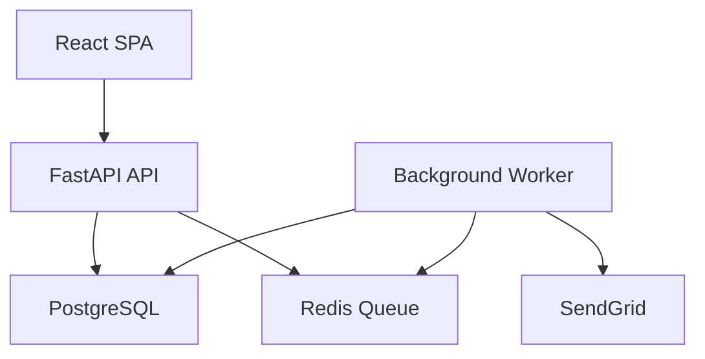
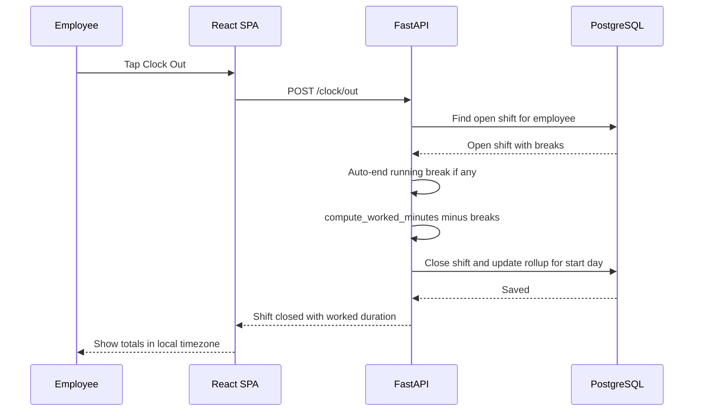
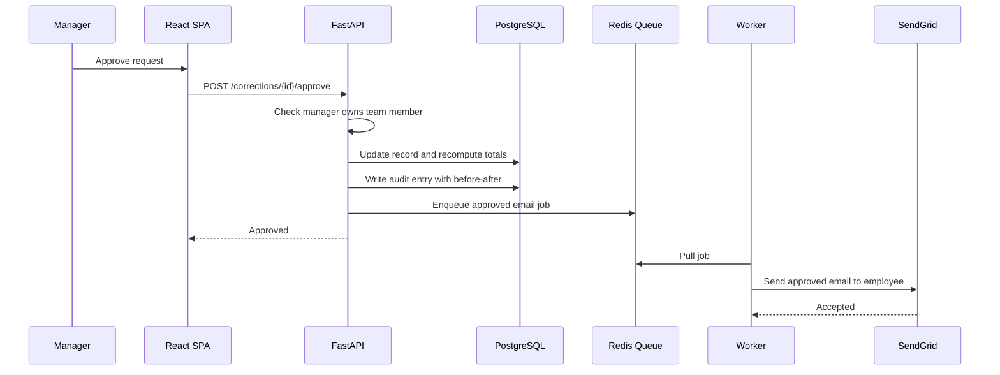
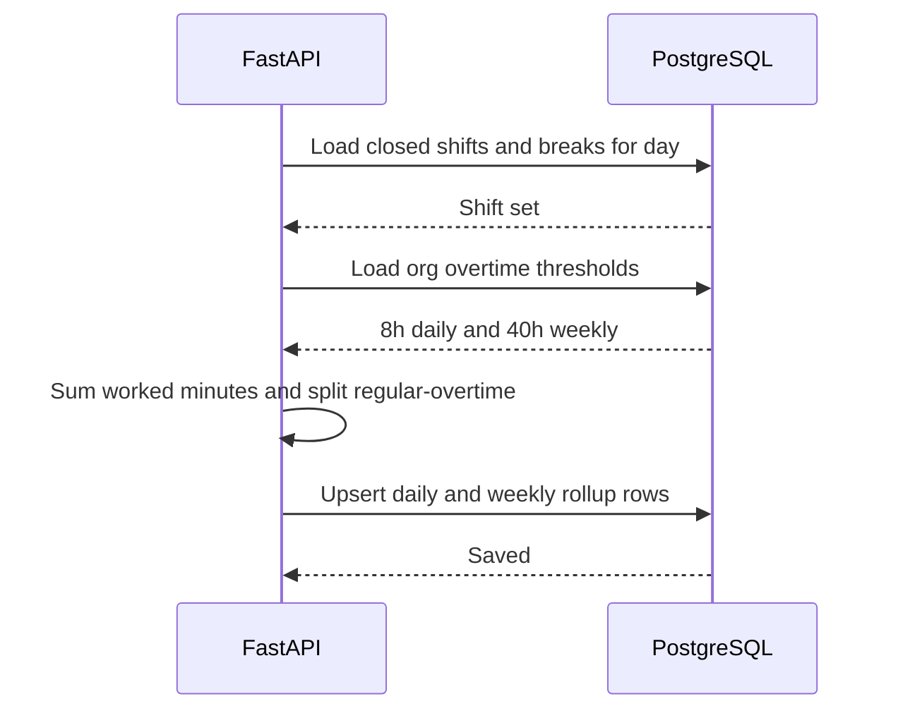
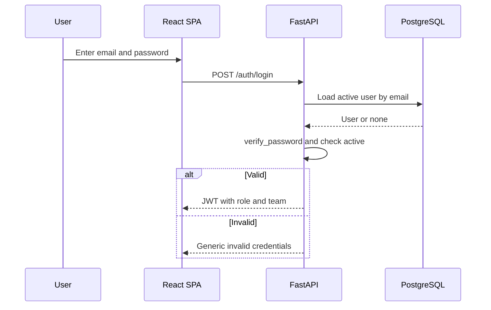
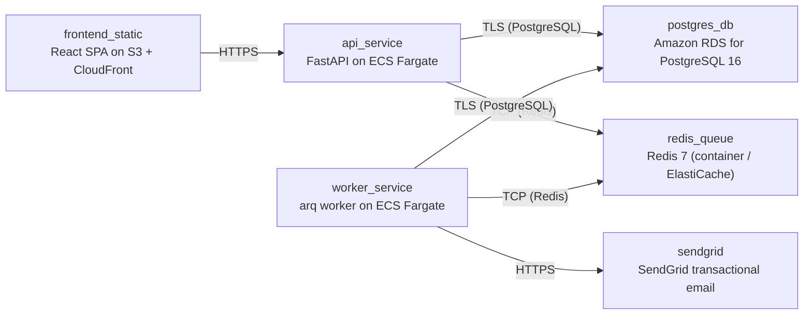

# Architecture

> Maintained by QuorQ AI SDLC. Text between `sdlc:auto` markers is regenerated; anything outside them is yours and is kept.

<!-- sdlc:auto:start narrative -->
## Overview

### ARCH-001 · approved · source: architecture:summary

Overall architecture approved (version 1) for a single-organisation time-tracking web app for under ~50 staff, covering employee clock-in/out and breaks, personal hours views, manager oversight and correction approval, and HR/Admin account, settings, export and privacy administration.

Approved stack: React 19 SPA frontend, FastAPI 0.115 backend, PostgreSQL 16 database, hosted on AWS, with SendGrid for transactional email and a Redis-backed queue for background email and scheduled missing-clock-out reminders. Design implements a GDPR-style privacy baseline (role-limited access, audit logging, encryption in transit and at rest, subject-rights handling) rather than clinical-grade high availability, because the requirements explicitly state no PHI is stored and the system is not a medical device despite the healthcare industry context.

- ⚠ Industry context is stated as healthcare but no regulation list (e.g. HIPAA) or domain skill checklist was provided in this input -- a human should confirm whether any healthcare-specific regulations apply beyond the GDPR-style baseline implemented, since the requirements assert no PHI is stored.
- ⚠ No explicit mapping from architecture decisions to specific US-00x requirement IDs was provided; traceability to the 24 known requirement keys needs confirmation.

### ARCH-002 · approved · source: architecture:components:web_frontend

React 19 single-page app serves every user-facing screen: sign-in, clock controls, personal hours, team oversight, correction workflow, admin settings and CSV export trigger.

Responsive SPA showing local-timezone timestamps throughout, and presenting a privacy notice for acknowledgement at first sign-in. No separate mobile app or public/SEO pages are in scope.

### ARCH-003 · approved · source: architecture:components:api_backend

FastAPI backend holds all core server-side logic for the app.

Responsibilities: authentication and JWT issuance, role-based access control, clock-in/out and break state machine, worked-duration and daily/weekly rollups with regular/overtime split, overnight-shift attribution, correction workflow, audit logging, CSV export, and GDPR subject-rights operations (export/erasure). Enqueues background jobs to the worker rather than sending email inline, keeping request handling instant.

### ARCH-004 · approved · source: architecture:components:worker

Background worker (arq, Python) processes queued jobs so the API never blocks on email delivery.

Consumes queued jobs to send correction-related and password-reset emails via SendGrid, and runs the scheduled missing-clock-out reminder check on a timer.

### ARCH-005 · approved · source: architecture:components:database

PostgreSQL 16 is the system of record for all attendance, correction, settings and audit data.

Stores employees, teams, shifts, breaks, correction requests, org settings, password-reset tokens, rollups and the audit log, using timezone-aware timestamps. Enforces entity relationships and performs the date arithmetic behind rollups. Encrypted at rest.

### ARCH-006 · approved · source: architecture:components:queue

Redis 7 provides the lightweight job queue and scheduler backing async work.

Backs background email delivery (correction and password-reset notifications) and the scheduled missing-clock-out reminder checks.

### ARCH-007 · approved · source: architecture:components:email_service

SendGrid (SaaS) delivers all transactional email for the app.

Sends correction submitted/approved/rejected notifications, password-reset links, and optional missing-clock-out reminders.

### ARCH-008 · approved · source: architecture:critical_paths:clock_in_out_overnight

Defines how clock-in/out, breaks and overnight shifts are handled and attributed to a work date.

Employee clocks in, creating an open shift; a second overlapping open shift is blocked. The employee may start/stop unpaid breaks while the shift is open. On clock-out, any running break is auto-ended. Worked duration = clock-out time minus clock-in time minus unpaid break time. The shift is attributed to the work_date of its start time in the employee's own timezone, even if the shift ends after midnight (overnight attribution).

### ARCH-009 · approved · source: architecture:critical_paths:correction_approval

Defines the correction-request submission and manager approval/rejection flow.

Employee submits a correction request with proposed clock-in/out times and a reason; it is saved as pending and the manager is emailed (via the queue, so submission stays instant). Manager approves or rejects requests for their own team only. Approval updates the underlying shift record and recomputes totals; rejection leaves the record unchanged but records a decision reason. Both outcomes write an audit entry and enqueue a notification email to the employee.

### ARCH-010 · approved · source: architecture:critical_paths:rollup_overtime

Defines how daily and weekly worked-hour totals are computed and split into regular vs overtime.

On shift close or any record edit, daily totals are summed as worked time minus unpaid breaks, then split into regular vs overtime against org-wide thresholds (default 8h/day). Weekly totals sum the daily totals and apply a weekly threshold (default 40h). Changing the thresholds in org settings triggers a recomputation across the whole organisation.

### ARCH-011 · approved · source: architecture:critical_paths:auth_rbac

Defines sign-in, JWT issuance, role-based data scoping and password reset.

Admin-provisioned accounts sign in with email and password; failed attempts return a generic error message (no detail leak). The issued JWT carries role and team. Every data request is filtered by role: employees see only their own data, managers see their team plus themselves, HR/Admin see org-wide data. Password reset issues a time-limited, single-use link delivered by email via the background queue.

### ARCH-012 · approved · source: architecture:entities

Data model covers teams, employees, shifts, breaks, rollups, correction requests, org settings, password-reset tokens and an audit log.

teams(id, name, manager_id); employees(id, name, email, password_hash, role, team_id, timezone, expected_start_time, standard_daily_hours, is_active, privacy_notice_acked_at, created_at); shifts(id, employee_id, clock_in_at, clock_out_at, work_date, worked_minutes, status); breaks(id, shift_id, break_start_at, break_end_at); daily_rollups(id, employee_id, work_date, regular_minutes, overtime_minutes, break_minutes, is_missing_late, is_under_hours); correction_requests(id, employee_id, shift_id, proposed_clock_in_at, proposed_clock_out_at, reason, status, reviewed_by, decision_reason, reviewed_at, created_at); org_settings(id, daily_threshold_hours, weekly_threshold_hours, missing_clockout_reminder_enabled, reminder_window_hours); password_reset_tokens(id, employee_id, token_hash, expires_at, used_at); audit_log(id, actor_id, action, entity_type, entity_id, before_value, after_value, created_at).

### ARCH-013 · approved · source: architecture:endpoints

API surface spans authentication, clock/break actions, personal and team views, corrections, admin/HR management, org settings, CSV export and GDPR subject-rights operations.

Auth: POST /auth/login (sign in, generic error on failure); GET /auth/me (profile, role, timezone, privacy-notice state); POST /auth/password-reset/request (neutral confirmation, enqueues email); POST /auth/password-reset/confirm (single-use time-limited token); POST /auth/privacy-notice/ack (record first-sign-in acknowledgement). Clock/Break: POST /clock/in (open a shift, blocked if one is already open); POST /clock/out (close shift, auto-end running break, compute duration); POST /clock/break/start; POST /clock/break/stop. Personal views: GET /me/dashboard (current shift/break status, elapsed time); GET /me/hours (own daily/weekly totals with regular/overtime/break breakdown, local timezone). Team/manager: GET /team/records (team clock events and rolled-up hours for a period); GET /team/flags (members missing/late or under expected hours); GET /team/corrections (pending team correction requests); POST /corrections/{id}/approve (update record, recompute totals, audit, email); POST /corrections/{id}/reject (reason, audit, email). Employee-side corrections: POST /corrections (submit, saved pending, manager emailed); GET /corrections (own requests and status). HR/Admin: POST /employees (create account, send invite/reset link); PATCH /employees/{id} (edit identity, role, team, timezone, schedule); DELETE /employees/{id} (deactivate, sign-in blocked, records retained); PATCH /records/{shift_id} (edit any clock/break times, recompute, audit). Settings: GET /settings, PATCH /settings (change thresholds/reminders, triggers org-wide recompute). Export: GET /export/timesheet.csv (per-employee regular/overtime/break and daily/weekly totals for a pay period; overnight shifts counted on their start day). Privacy: GET /privacy/{employee_id}/export (personal-data export for access requests); DELETE /privacy/{employee_id} (delete/anonymise, recorded in audit log). Audit: GET /audit-log (review entries for relevant employees).

### ARCH-014 · approved · source: architecture:deployment_nodes

Deployment topology runs entirely on AWS with managed services for the database, queue and email.

frontend_static: React SPA static build served via S3 + CloudFront. api_service: FastAPI on ECS Fargate, Python 3.12 container running uvicorn. worker_service: arq worker on ECS Fargate, Python 3.12 container. postgres_db: Amazon RDS for PostgreSQL 16 (managed). redis_queue: Redis 7, container/ElastiCache (redis:7-alpine). sendgrid: SendGrid transactional email via SaaS API.

### ARCH-015 · approved · source: architecture:technology_decisions

Technology choices and the alternatives considered for each layer of the stack.

Frontend: React 19 chosen over Next.js/Vue -- an in-house responsive SPA covers every screen needed for under ~50 staff with no public/SEO pages, served statically via CloudFront. Backend: FastAPI 0.115 chosen over Django REST Framework/Flask -- the product's core complexity is server-side date/time logic (worked-duration and daily/weekly rollups, regular/overtime split, overnight attribution, timezone handling, RBAC, correction audit trail), which FastAPI handles well at low concurrency with easy CSV output. Database: PostgreSQL 16 chosen over MySQL/SQLite -- attendance data is relational and time-sensitive; PostgreSQL enforces employee/team/shift/break/correction/audit relationships, stores timezone-aware timestamptz natively, and reliably runs the date arithmetic behind rollups. Cloud: AWS chosen over Azure/GCP -- offers region choice for the mixed-region GDPR-style baseline, managed PostgreSQL (RDS) with encryption at rest and backups, and cheap hosting suited to a small internal tool.
<!-- sdlc:auto:end narrative -->

<!-- sdlc:auto:start building-blocks -->
## Building Block View

| ID | Name | Technology | Responsibility | Depends on |
|---|---|---|---|---|
| web_frontend | React SPA | React 19 | Responsive single-page web app for all screens (sign-in, clock controls, personal hours, team oversight, correction workflow, admin settings, CSV export trigger). Shows local-timezone timestamps and privacy notice at first sign-in. | api_backend |
| api_backend | FastAPI API | FastAPI 0.115 | Core server-side logic: authentication and JWT issuance, role-based access control, clock-in/out and break state machine, worked-duration and daily/weekly rollups with regular/overtime split, overnight-shift attribution, correction workflow, audit logging, CSV export, and GDPR subject-rights operations. Enqueues background jobs. | database, queue |
| worker | Background Worker | arq worker (Python) | Consumes queued jobs to send correction and password-reset emails via SendGrid, and runs the scheduled missing-clock-out reminder check, keeping clock-in and approval requests instant. | database, queue, email_service |
| database | PostgreSQL | PostgreSQL 16 | Stores employees, teams, shifts, breaks, correction requests, org settings, password-reset tokens, rollups and the audit log with timezone-aware timestamps; enforces relationships and runs date arithmetic. Encrypted at rest. | — |
| queue | Redis Queue | Redis 7 | Lightweight job queue and timed scheduler backing background email delivery and missing-clock-out reminders. | — |
| email_service | SendGrid | SendGrid (SaaS) | Transactional email delivery for correction submitted/approved/rejected, password-reset links and optional missing-clock-out reminders. | — |

<!-- sdlc:auto:end building-blocks -->

<!-- sdlc:auto:start runtime -->
## Runtime View

### Clock in/out with overnight attribution

Employee clocks in creating an open shift (second overlapping shift blocked), optionally takes breaks, then clocks out. Any running break is auto-ended. Worked duration = clock-out minus clock-in minus unpaid breaks. The shift is attributed to the work_date of its start in the employee's timezone even if it ends after midnight.

- **Components:** web_frontend, api_backend, database
- **Modules:** clock_service, shift_repository, break_repository, rollup_service
- **Key functions:** clock_in(employee_id), clock_out(employee_id), start_break(shift_id), stop_break(shift_id), attribute_work_date(clock_in_at, tz), compute_worked_minutes(shift)

### Correction request approval

Employee submits a correction with proposed times and reason (saved pending, manager emailed). Manager approves or rejects on their team only. Approval updates the record and recomputes totals, rejection leaves it unchanged with a reason. Both write an audit entry and enqueue the employee email so the request stays instant.

- **Components:** web_frontend, api_backend, database, queue, worker, email_service
- **Modules:** correction_service, rbac, audit_service, rollup_service, notification_jobs
- **Key functions:** submit_correction(employee_id, payload), approve_correction(mgr_id, req_id), reject_correction(mgr_id, req_id, reason), recompute_rollups(employee_id, date), write_audit(actor, action, before, after), enqueue_email(job)

### Daily and weekly rollup with overtime split

On shift close or record edit, totals per day are summed (worked minus unpaid breaks) and split regular vs overtime against org-wide thresholds (default 8h/day). Weekly totals sum daily totals and apply the weekly threshold (default 40h). Changing thresholds triggers recomputation org-wide.

- **Components:** api_backend, database
- **Modules:** rollup_service, settings_repository, flagging_service
- **Key functions:** rollup_day(employee_id, date, thresholds), rollup_week(employee_id, iso_week, thresholds), split_regular_overtime(minutes, daily_threshold), recompute_all(thresholds), flag_missing_or_late(employee_id, date)

### Authentication and role-based access

Admin-provisioned accounts sign in with email and password; failures return a generic message. JWT carries role and team. Every data request is filtered by role: employees see only their own data, managers their team plus themselves, HR/Admin org-wide. Password reset issues a time-limited single-use link emailed via the queue.

- **Components:** web_frontend, api_backend, database, queue, worker, email_service
- **Modules:** auth_service, rbac, token_repository, notification_jobs
- **Key functions:** login(email, password), verify_password(hash, plain), issue_jwt(user), require_role(roles), scope_query(user, query), request_reset(email), confirm_reset(token, new_password)

<!-- sdlc:auto:end runtime -->

<!-- sdlc:auto:start deployment-view -->
## Deployment View

| Name | Service | Runtime | Scaling | Environment |
|---|---|---|---|---|
| frontend_static | React SPA on S3 + CloudFront | Static build (CDN) | CDN-served, no instance scaling | dev |
| api_service | FastAPI on ECS Fargate | Python 3.12 container (uvicorn) | 1 task (low concurrency, <50 users) | dev |
| worker_service | arq worker on ECS Fargate | Python 3.12 container | 1 task | dev |
| postgres_db | Amazon RDS for PostgreSQL 16 | Managed PostgreSQL 16 | Single instance, encryption at rest (KMS), automated backups | dev |
| redis_queue | Redis 7 (container / ElastiCache) | redis:7-alpine | Single node | dev |
| sendgrid | SendGrid transactional email | SaaS API | Managed by provider | dev |

| Source | Target | Protocol |
|---|---|---|
| frontend_static | api_service | HTTPS |
| api_service | postgres_db | TLS (PostgreSQL) |
| api_service | redis_queue | TCP (Redis) |
| worker_service | redis_queue | TCP (Redis) |
| worker_service | postgres_db | TLS (PostgreSQL) |
| worker_service | sendgrid | HTTPS |

<!-- sdlc:auto:end deployment-view -->

<!-- sdlc:auto:start decisions -->
## Architecture Decisions

| Layer | Choice | ADR |
|---|---|---|
| Frontend | React 19 | [ADR-0001](adr/frontend.md) |
| Backend | FastAPI 0.115 | [ADR-0002](adr/backend.md) |
| Database | PostgreSQL 16 | [ADR-0003](adr/database.md) |
| Cloud | AWS | [ADR-0004](adr/cloud.md) |
<!-- sdlc:auto:end decisions -->

<!-- sdlc:auto:start links -->
## Related Documents

- [Data Model](data-model.md)
- [API Specification](api/openapi.yaml)
- [Architecture Decision Records](adr/README.md)
<!-- sdlc:auto:end links -->
