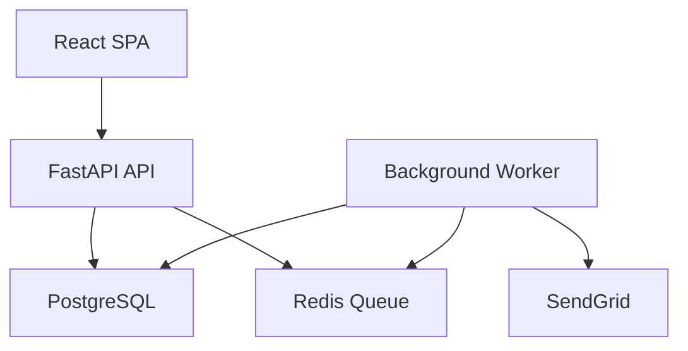
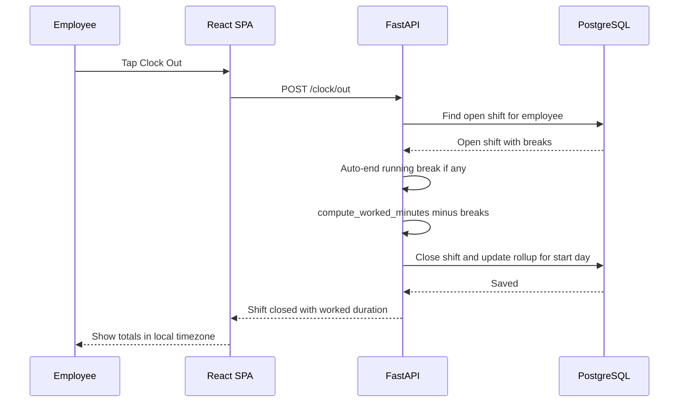
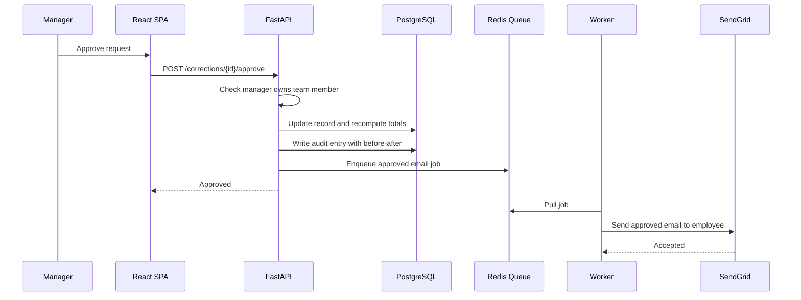
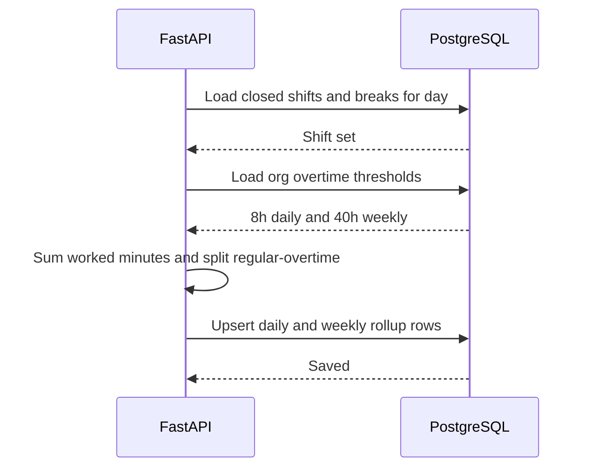
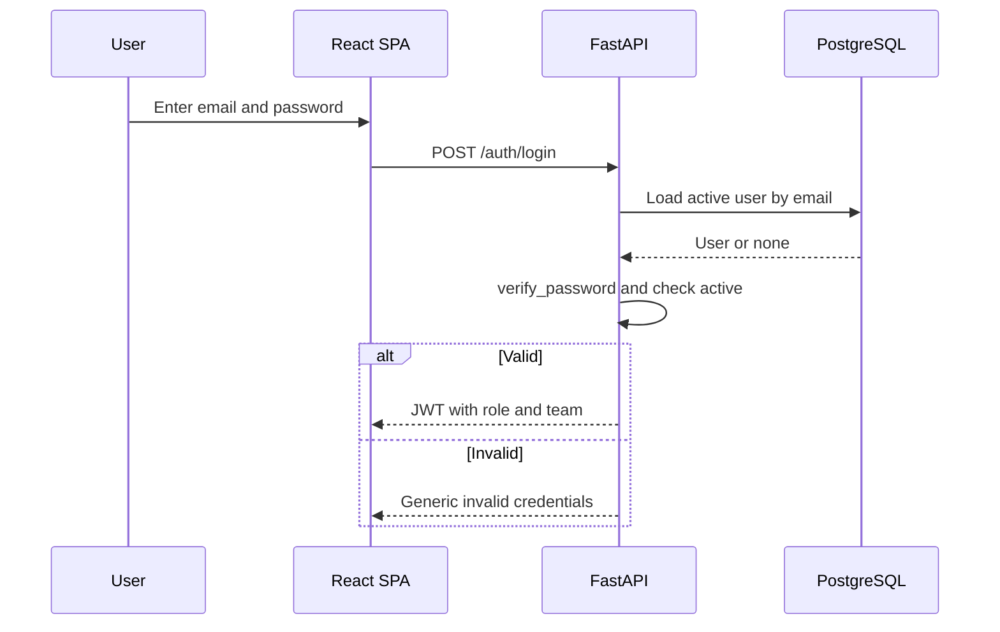
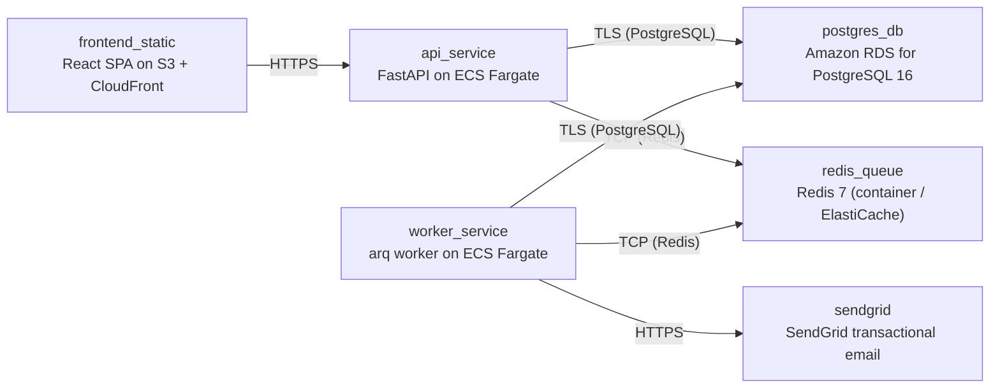

# Architecture

> Maintained by QuorQ AI SDLC. Text between `sdlc:auto` markers is regenerated; anything outside them is yours and is kept.

<!-- sdlc:auto:start narrative -->
## Overview

### ARCH-001 · approved · source: architecture:summary/components

Architecture v1 (approved): React SPA + FastAPI backend + PostgreSQL, with a Redis-backed worker for background email/reminders via SendGrid, all on AWS.

Components:
- web_frontend: React 19 responsive SPA covering sign-in, clock controls, personal hours, team oversight, corrections, admin settings, CSV export trigger; shows local-timezone timestamps and the first-sign-in privacy notice.
- api_backend: FastAPI 0.115 -- auth/JWT, RBAC, clock-in/out and break state machine, worked-duration and rollup computation, overnight attribution, correction workflow, audit logging, CSV export, GDPR subject-rights operations; enqueues background jobs.
- worker: arq worker (Python) consuming queued jobs for correction/reset emails via SendGrid and the scheduled missing-clock-out reminder check.
- database: PostgreSQL 16, timezone-aware timestamps, encrypted at rest, stores employees/teams/shifts/breaks/corrections/settings/reset-tokens/rollups/audit-log.
- queue: Redis 7 job queue and scheduler for background email and reminders.
- email_service: SendGrid SaaS transactional email for correction events, password resets, and reminders.
- Explicitly notes industry context is healthcare but confirms no PHI is stored and the system is not a medical device, so only the GDPR-style baseline (not clinical-grade controls) is implemented.

**Related:** REQ-SCOPE-001, EPIC-001, EPIC-002, EPIC-003, EPIC-006, EPIC-008, EPIC-009, EPIC-010

- ⚠ No explicit AWS region or data-residency configuration is specified, despite the stated mixed-region GDPR-style rationale for choosing AWS -- flagged for formalisation as the org grows.

### ARCH-002 · approved · source: architecture:critical_path:clock_in_out_overnight

Design for the clock-in/out and break state machine, including overnight-shift attribution.

Employee clocks in, creating an open shift (a second overlapping open shift is blocked). Employee may start/stop unpaid breaks; any running break is auto-ended at clock-out. Worked duration = clock-out minus clock-in minus unpaid breaks. The shift is attributed to the work_date of its start, in the employee's timezone, even if it ends after midnight.

**Related:** US-004, US-005, US-006, EPIC-002

### ARCH-003 · approved · source: architecture:critical_path:correction_approval

Design for the correction-request submission and manager approval/rejection flow.

Employee submits a correction with proposed times and reason; saved pending, manager emailed (via queue). Manager approves or rejects, scoped to their own team only. Approval updates the record and recomputes totals; rejection leaves the record unchanged and records a reason. Both outcomes write an audit entry and enqueue the employee notification email so the approve/reject request itself stays instant.

**Related:** US-013, US-014, EPIC-006

### ARCH-004 · approved · source: architecture:critical_path:rollup_overtime

Design for daily/weekly rollup computation and the regular/overtime split.

On shift close or record edit, daily totals (worked minus unpaid breaks) are summed and split regular vs overtime against org-wide thresholds (default 8h/day). Weekly totals sum daily totals and apply the weekly threshold (default 40h). Changing thresholds in org_settings triggers org-wide recomputation.

**Related:** US-007, US-008, EPIC-003

### ARCH-005 · approved · source: architecture:critical_path:auth_rbac

Design for authentication, JWT-based sessions, and role-based data scoping.

Admin-provisioned accounts sign in with email/password; failures return a generic message. JWT carries role and team. Every data request is filtered by role: employees see only their own data, managers see their team plus themselves, HR/Admin see org-wide. Password reset issues a time-limited, single-use link emailed via the queue.

**Related:** US-001, US-002, US-003, EPIC-001

### ARCH-006 · approved · source: architecture:entities

Relational data model backing attendance, corrections, settings, and the audit trail.

- teams: id, name, manager_id.
- employees: id, name, email, password_hash, role, team_id, timezone, expected_start_time, standard_daily_hours, is_active, privacy_notice_acked_at, created_at.
- shifts: id, employee_id, clock_in_at, clock_out_at, work_date, worked_minutes, status.
- breaks: id, shift_id, break_start_at, break_end_at.
- daily_rollups: id, employee_id, work_date, regular_minutes, overtime_minutes, break_minutes, is_missing_late, is_under_hours.
- correction_requests: id, employee_id, shift_id, proposed_clock_in_at, proposed_clock_out_at, reason, status, reviewed_by, decision_reason, reviewed_at, created_at.
- org_settings: id, daily_threshold_hours, weekly_threshold_hours, missing_clockout_reminder_enabled, reminder_window_hours.
- password_reset_tokens: id, employee_id, token_hash, expires_at, used_at.
- audit_log: id, actor_id, action, entity_type, entity_id, before_value, after_value, created_at.

**Related:** EPIC-001, EPIC-002, EPIC-003, EPIC-005, EPIC-006, EPIC-008, EPIC-010

### ARCH-007 · approved · source: architecture:endpoints

REST API surface grouped by function: auth, clocking, personal/team views, corrections, admin/settings, export, privacy, and audit.

- Auth: POST /auth/login, GET /auth/me, POST /auth/password-reset/request, POST /auth/password-reset/confirm, POST /auth/privacy-notice/ack.
- Clocking: POST /clock/in, POST /clock/out, POST /clock/break/start, POST /clock/break/stop.
- Personal views: GET /me/dashboard, GET /me/hours.
- Team views: GET /team/records, GET /team/flags, GET /team/corrections.
- Corrections: POST /corrections, GET /corrections, POST /corrections/{id}/approve, POST /corrections/{id}/reject.
- Admin: POST /employees, PATCH /employees/{id}, DELETE /employees/{id}, PATCH /records/{shift_id}, GET /settings, PATCH /settings.
- Export: GET /export/timesheet.csv.
- Privacy/audit: GET /privacy/{employee_id}/export, DELETE /privacy/{employee_id}, GET /audit-log.

**Related:** US-001, US-002, US-004, US-005, US-009, US-010, US-011, US-013, US-014, US-017, US-019, US-020, US-021, US-022, US-023

### ARCH-008 · approved · source: architecture:deployment_nodes

AWS deployment topology for the SPA, API, worker, database, queue, and email provider.

- frontend_static: React SPA on S3 + CloudFront (static build/CDN).
- api_service: FastAPI on ECS Fargate, Python 3.12 container (uvicorn).
- worker_service: arq worker on ECS Fargate, Python 3.12 container.
- postgres_db: Amazon RDS for PostgreSQL 16 (managed).
- redis_queue: Redis 7 (container/ElastiCache, redis:7-alpine).
- sendgrid: SendGrid transactional email (SaaS API).
- Sized for standard (non-clinical-grade) availability per NFR-010, matching the under-50-employee, low-concurrency scale (NFR-014).

**Related:** NFR-005, NFR-010, NFR-013, NFR-014

- ⚠ No explicit region, backup/retention schedule, or disaster-recovery target is stated for RDS/ElastiCache beyond 'standard availability'.

### ARCH-009 · approved · source: architecture:technology_decisions

Rationale for the four approved technology choices, each with alternatives considered.

- Frontend: React 19 (vs. Next.js, Vue) -- in-house responsive SPA for under ~50 staff, no public/SEO pages, served statically via CloudFront.
- Backend: FastAPI 0.115 (vs. Django REST Framework, Flask) -- suited to server-side date/time logic (rollups, overtime split, overnight attribution, timezone handling, RBAC, audit trail) at low concurrency with easy CSV output.
- Database: PostgreSQL 16 (vs. MySQL, SQLite) -- enforces relational integrity across employee/team/shift/break/correction/audit entities, native timezone-aware timestamptz, reliable date arithmetic.
- Cloud: AWS (vs. Azure, GCP) -- region choice for mixed-region GDPR-style baseline, managed PostgreSQL (RDS) with encryption/backups, cheap hosting for a small internal tool.

**Related:** REQ-SCOPE-001
<!-- sdlc:auto:end narrative -->

<!-- sdlc:auto:start building-blocks -->
## Building Block View

| ID | Name | Technology | Responsibility | Depends on |
|---|---|---|---|---|
| web_frontend | React SPA | React 19 | Responsive single-page web app for all screens (sign-in, clock controls, personal hours, team oversight, correction workflow, admin settings, CSV export trigger). Shows local-timezone timestamps and privacy notice at first sign-in. | api_backend |
| api_backend | FastAPI API | FastAPI 0.115 | Core server-side logic: authentication and JWT issuance, role-based access control, clock-in/out and break state machine, worked-duration and daily/weekly rollups with regular/overtime split, overnight-shift attribution, correction workflow, audit logging, CSV export, and GDPR subject-rights operations. Enqueues background jobs. | database, queue |
| worker | Background Worker | arq worker (Python) | Consumes queued jobs to send correction and password-reset emails via SendGrid, and runs the scheduled missing-clock-out reminder check, keeping clock-in and approval requests instant. | database, queue, email_service |
| database | PostgreSQL | PostgreSQL 16 | Stores employees, teams, shifts, breaks, correction requests, org settings, password-reset tokens, rollups and the audit log with timezone-aware timestamps; enforces relationships and runs date arithmetic. Encrypted at rest. | — |
| queue | Redis Queue | Redis 7 | Lightweight job queue and timed scheduler backing background email delivery and missing-clock-out reminders. | — |
| email_service | SendGrid | SendGrid (SaaS) | Transactional email delivery for correction submitted/approved/rejected, password-reset links and optional missing-clock-out reminders. | — |

<!-- sdlc:auto:end building-blocks -->

<!-- sdlc:auto:start runtime -->
## Runtime View

### Clock in/out with overnight attribution

Employee clocks in creating an open shift (second overlapping shift blocked), optionally takes breaks, then clocks out. Any running break is auto-ended. Worked duration = clock-out minus clock-in minus unpaid breaks. The shift is attributed to the work_date of its start in the employee's timezone even if it ends after midnight.

- **Components:** web_frontend, api_backend, database
- **Modules:** clock_service, shift_repository, break_repository, rollup_service
- **Key functions:** clock_in(employee_id), clock_out(employee_id), start_break(shift_id), stop_break(shift_id), attribute_work_date(clock_in_at, tz), compute_worked_minutes(shift)

### Correction request approval

Employee submits a correction with proposed times and reason (saved pending, manager emailed). Manager approves or rejects on their team only. Approval updates the record and recomputes totals, rejection leaves it unchanged with a reason. Both write an audit entry and enqueue the employee email so the request stays instant.

- **Components:** web_frontend, api_backend, database, queue, worker, email_service
- **Modules:** correction_service, rbac, audit_service, rollup_service, notification_jobs
- **Key functions:** submit_correction(employee_id, payload), approve_correction(mgr_id, req_id), reject_correction(mgr_id, req_id, reason), recompute_rollups(employee_id, date), write_audit(actor, action, before, after), enqueue_email(job)

### Daily and weekly rollup with overtime split

On shift close or record edit, totals per day are summed (worked minus unpaid breaks) and split regular vs overtime against org-wide thresholds (default 8h/day). Weekly totals sum daily totals and apply the weekly threshold (default 40h). Changing thresholds triggers recomputation org-wide.

- **Components:** api_backend, database
- **Modules:** rollup_service, settings_repository, flagging_service
- **Key functions:** rollup_day(employee_id, date, thresholds), rollup_week(employee_id, iso_week, thresholds), split_regular_overtime(minutes, daily_threshold), recompute_all(thresholds), flag_missing_or_late(employee_id, date)

### Authentication and role-based access

Admin-provisioned accounts sign in with email and password; failures return a generic message. JWT carries role and team. Every data request is filtered by role: employees see only their own data, managers their team plus themselves, HR/Admin org-wide. Password reset issues a time-limited single-use link emailed via the queue.

- **Components:** web_frontend, api_backend, database, queue, worker, email_service
- **Modules:** auth_service, rbac, token_repository, notification_jobs
- **Key functions:** login(email, password), verify_password(hash, plain), issue_jwt(user), require_role(roles), scope_query(user, query), request_reset(email), confirm_reset(token, new_password)

<!-- sdlc:auto:end runtime -->

<!-- sdlc:auto:start deployment-view -->
## Deployment View

| Name | Service | Runtime | Scaling | Environment |
|---|---|---|---|---|
| frontend_static | React SPA on S3 + CloudFront | Static build (CDN) | CDN-served, no instance scaling | dev |
| api_service | FastAPI on ECS Fargate | Python 3.12 container (uvicorn) | 1 task (low concurrency, <50 users) | dev |
| worker_service | arq worker on ECS Fargate | Python 3.12 container | 1 task | dev |
| postgres_db | Amazon RDS for PostgreSQL 16 | Managed PostgreSQL 16 | Single instance, encryption at rest (KMS), automated backups | dev |
| redis_queue | Redis 7 (container / ElastiCache) | redis:7-alpine | Single node | dev |
| sendgrid | SendGrid transactional email | SaaS API | Managed by provider | dev |

| Source | Target | Protocol |
|---|---|---|
| frontend_static | api_service | HTTPS |
| api_service | postgres_db | TLS (PostgreSQL) |
| api_service | redis_queue | TCP (Redis) |
| worker_service | redis_queue | TCP (Redis) |
| worker_service | postgres_db | TLS (PostgreSQL) |
| worker_service | sendgrid | HTTPS |

<!-- sdlc:auto:end deployment-view -->

<!-- sdlc:auto:start decisions -->
## Architecture Decisions

| Layer | Choice | ADR |
|---|---|---|
| Frontend | React 19 | [ADR-0001](adr/frontend.md) |
| Backend | FastAPI 0.115 | [ADR-0002](adr/backend.md) |
| Database | PostgreSQL 16 | [ADR-0003](adr/database.md) |
| Cloud | AWS | [ADR-0004](adr/cloud.md) |
<!-- sdlc:auto:end decisions -->

<!-- sdlc:auto:start links -->
## Related Documents

- [Data Model](data-model.md)
- [API Specification](api/openapi.yaml)
- [Architecture Decision Records](adr/README.md)
<!-- sdlc:auto:end links -->
