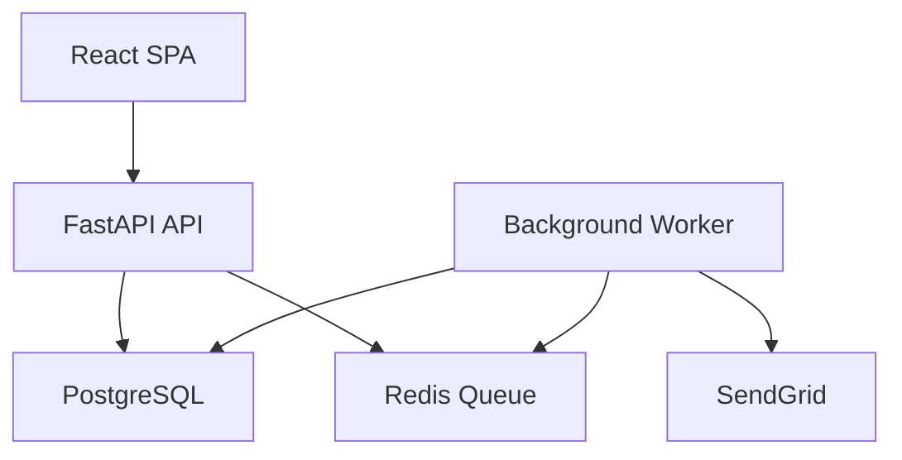
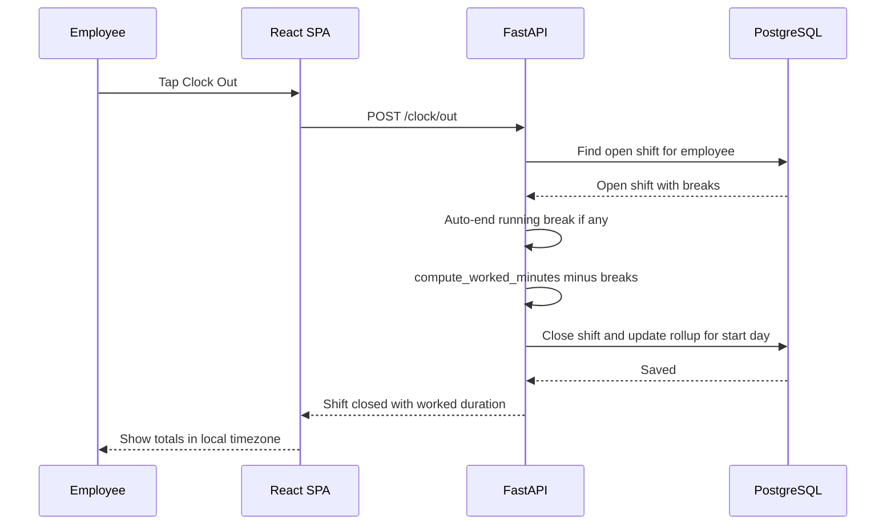
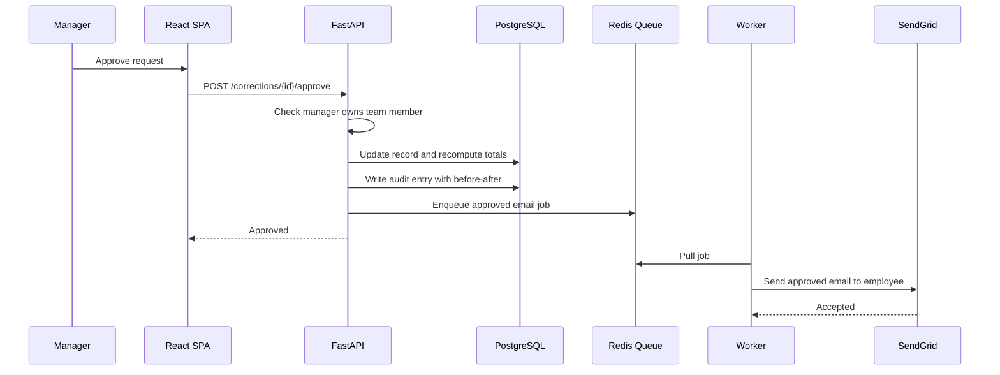
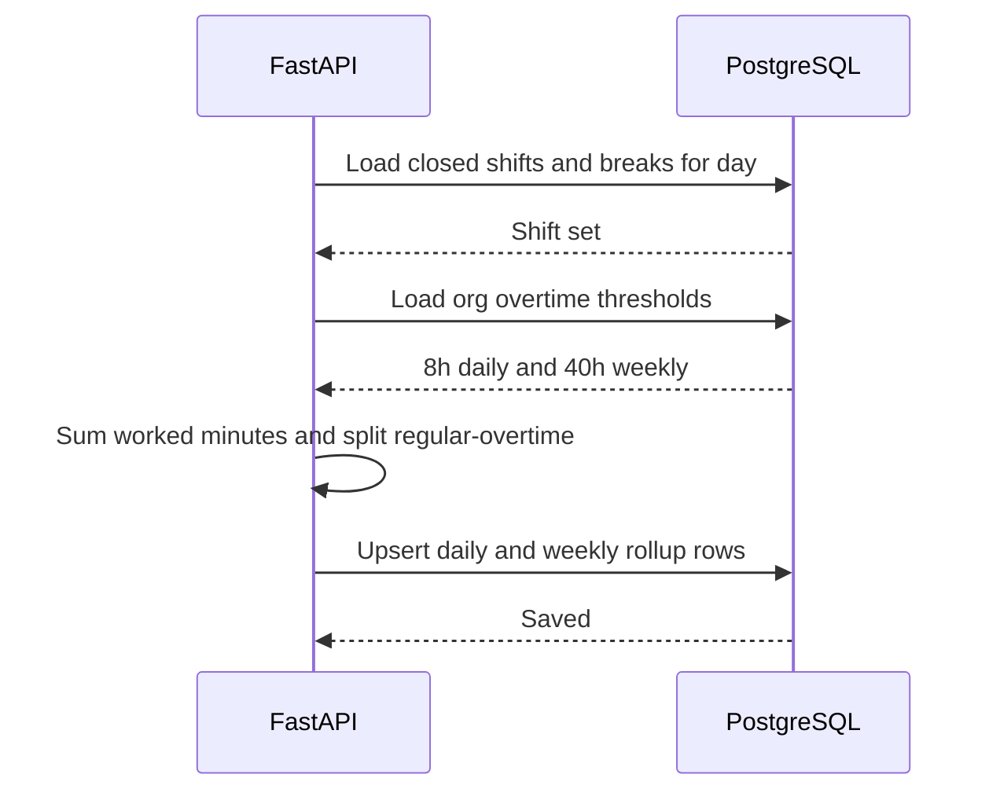
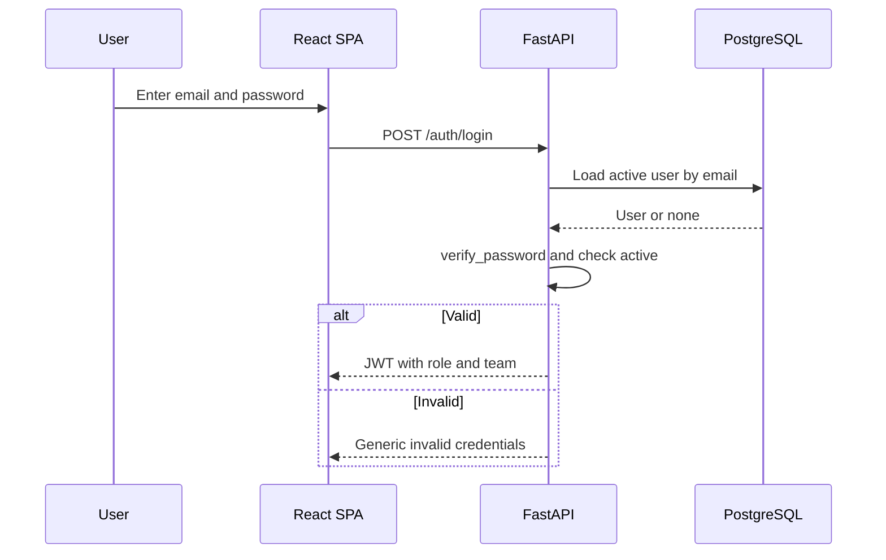
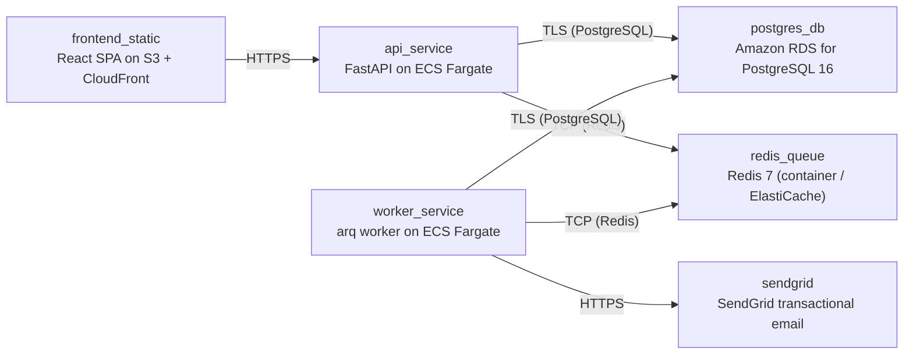

# Architecture

> Maintained by QuorQ AI SDLC. Text between `sdlc:auto` markers is regenerated; anything outside them is yours and is kept.

<!-- sdlc:auto:start narrative -->
## Overview

### ARCH-001 · approved · source: architecture

Approved v1 architecture: a React 19 SPA frontend, FastAPI 0.115 backend, PostgreSQL 16 database, a Redis-backed arq worker for background jobs, and SendGrid for email, hosted on AWS. Implements the product-owner-approved stack exactly, with no substitutions.

Components: web_frontend (React 19 SPA) -- all screens: sign-in, clock controls, personal hours, team oversight, correction workflow, admin settings, CSV export trigger; shows local-timezone timestamps and the privacy notice at first sign-in. api_backend (FastAPI 0.115) -- authentication/JWT issuance, RBAC, clock-in/out and break state machine, worked-duration and daily/weekly rollups with regular/overtime split, overnight-shift attribution, correction workflow, audit logging, CSV export, GDPR subject-rights operations; enqueues background jobs. worker (arq worker, Python) -- consumes queued jobs to send correction and password-reset emails via SendGrid and runs the scheduled missing-clock-out reminder check, keeping clock-in/approval requests instant. database (PostgreSQL 16) -- stores employees, teams, shifts, breaks, correction_requests, org_settings, password_reset_tokens, daily_rollups, and audit_log with timezone-aware timestamps; enforces relationships and runs date arithmetic; encrypted at rest. queue (Redis 7) -- lightweight job queue and timed scheduler backing background email delivery and reminders. email_service (SendGrid SaaS) -- transactional delivery for correction submitted/approved/rejected, password-reset links, and optional reminders. Entities: teams(id,name,manager_id); employees(id,name,email,password_hash,role,team_id,timezone,expected_start_time,standard_daily_hours,is_active,privacy_notice_acked_at,created_at); shifts(id,employee_id,clock_in_at,clock_out_at,work_date,worked_minutes,status); breaks(id,shift_id,break_start_at,break_end_at); daily_rollups(id,employee_id,work_date,regular_minutes,overtime_minutes,break_minutes,is_missing_late,is_under_hours); correction_requests(id,employee_id,shift_id,proposed_clock_in_at,proposed_clock_out_at,reason,status,reviewed_by,decision_reason,reviewed_at,created_at); org_settings(id,daily_threshold_hours,weekly_threshold_hours,missing_clockout_reminder_enabled,reminder_window_hours); password_reset_tokens(id,employee_id,token_hash,expires_at,used_at); audit_log(id,actor_id,action,entity_type,entity_id,before_value,after_value,created_at). Endpoints span auth (/auth/login, /auth/me, /auth/password-reset/request, /auth/password-reset/confirm, /auth/privacy-notice/ack), clocking (/clock/in, /clock/out, /clock/break/start, /clock/break/stop), personal views (/me/dashboard, /me/hours), team oversight (/team/records, /team/flags, /team/corrections), corrections (/corrections, /corrections/{id}/approve, /corrections/{id}/reject), admin (/employees POST/PATCH/DELETE, /records/{shift_id}, /settings GET/PATCH), export (/export/timesheet.csv), and privacy/audit (/privacy/{employee_id}/export, DELETE /privacy/{employee_id}, /audit-log). Deployment nodes: frontend_static (React SPA on S3+CloudFront), api_service (FastAPI on ECS Fargate, Python 3.12/uvicorn), worker_service (arq worker on ECS Fargate), postgres_db (Amazon RDS for PostgreSQL 16), redis_queue (Redis 7 container/ElastiCache), sendgrid (SaaS API). Technology decisions and rationale: React 19 over Next.js/Vue -- in-house responsive SPA covering every screen for under ~50 staff with no public/SEO pages, served statically via CloudFront; FastAPI 0.115 over Django REST Framework/Flask -- the product is mostly server-side date/time logic (rollups, overtime split, overnight attribution, timezone handling, RBAC, audit trail) handled comfortably at low concurrency; PostgreSQL 16 over MySQL/SQLite -- attendance data is relational and time-sensitive, native timezone-aware timestamptz and reliable date arithmetic; AWS over Azure/GCP -- region choice for the mixed-region GDPR-style baseline, managed PostgreSQL (RDS) with encryption/backups, and cheap hosting for a small internal tool.

**Related:** EPIC-001, EPIC-002, EPIC-003, EPIC-004, EPIC-005, EPIC-006, EPIC-007, EPIC-008, EPIC-009, EPIC-010

- ⚠ Architecture does not explicitly address WCAG accessibility implementation for the React SPA.

### ARCH-CP-001 · approved · source: architecture:critical_path:Clock in/out with overnight attribution

Describes the shift state machine from clock-in through breaks to clock-out, including overnight-shift attribution to the start day.

Employee clocks in via POST /clock/in, creating an open shift (a second overlapping shift is blocked). Within the open shift the employee may start/stop unpaid breaks via POST /clock/break/start and /clock/break/stop. On POST /clock/out, any running break is auto-ended; worked duration is computed as clock-out minus clock-in minus unpaid breaks. The shift is attributed to the work_date of its start in the employee's configured timezone even if it ends after midnight, so overnight shifts roll up against their start day.

**Related:** US-004, US-005, US-006, AC-009, AC-010, AC-011, AC-012, AC-013, AC-014, AC-015, AC-016

### ARCH-CP-002 · approved · source: architecture:critical_path:Correction request approval

Describes the correction-request lifecycle from employee submission through manager decision, including audit and notification handling.

Employee submits a correction with proposed times and a reason via POST /corrections; it is saved pending and the manager is emailed (job enqueued, not inline). The manager reviews via GET /team/corrections and acts only on their own team: POST /corrections/{id}/approve updates the affected record, recomputes totals, writes an audit entry, and enqueues an employee notification email; POST /corrections/{id}/reject leaves the record unchanged, records the reason, writes an audit entry, and enqueues an employee notification email. Enqueuing the email (rather than sending inline) keeps the approve/reject request itself instant.

**Related:** US-013, US-014, AC-030, AC-031, AC-032, AC-033

### ARCH-CP-003 · approved · source: architecture:critical_path:Daily and weekly rollup with overtime split

Describes how worked time is totaled per day and week and split into regular vs overtime against org-wide, admin-configurable thresholds.

On shift close or record edit, the daily total (worked minus unpaid breaks) is summed and split into regular vs overtime against the org-wide daily threshold (default 8h). Weekly totals sum the daily totals and apply the weekly threshold (default 40h) to classify overtime. Changing thresholds via PATCH /settings triggers org-wide recomputation of existing rollups and exports.

**Related:** US-007, US-008, US-020, AC-017, AC-018, AC-019, AC-020, AC-021

### ARCH-CP-004 · approved · source: architecture:critical_path:Authentication and role-based access

Describes sign-in, JWT-based role/team scoping, and the password-reset flow.

Admin-provisioned accounts sign in via POST /auth/login with email and password; failures return a generic error message. A successful sign-in issues a JWT carrying role and team. Every subsequent data request is filtered by role: employees see only their own data, managers see their team plus themselves, HR/Admin see the whole organisation. Password reset issues a time-limited, single-use link emailed via the background queue (POST /auth/password-reset/request, POST /auth/password-reset/confirm).

**Related:** US-001, US-002, US-003, AC-001, AC-002, AC-006, AC-007, AC-008
<!-- sdlc:auto:end narrative -->

<!-- sdlc:auto:start building-blocks -->
## Building Block View

| ID | Name | Technology | Responsibility | Depends on |
|---|---|---|---|---|
| web_frontend | React SPA | React 19 | Responsive single-page web app for all screens (sign-in, clock controls, personal hours, team oversight, correction workflow, admin settings, CSV export trigger). Shows local-timezone timestamps and privacy notice at first sign-in. | api_backend |
| api_backend | FastAPI API | FastAPI 0.115 | Core server-side logic: authentication and JWT issuance, role-based access control, clock-in/out and break state machine, worked-duration and daily/weekly rollups with regular/overtime split, overnight-shift attribution, correction workflow, audit logging, CSV export, and GDPR subject-rights operations. Enqueues background jobs. | database, queue |
| worker | Background Worker | arq worker (Python) | Consumes queued jobs to send correction and password-reset emails via SendGrid, and runs the scheduled missing-clock-out reminder check, keeping clock-in and approval requests instant. | database, queue, email_service |
| database | PostgreSQL | PostgreSQL 16 | Stores employees, teams, shifts, breaks, correction requests, org settings, password-reset tokens, rollups and the audit log with timezone-aware timestamps; enforces relationships and runs date arithmetic. Encrypted at rest. | — |
| queue | Redis Queue | Redis 7 | Lightweight job queue and timed scheduler backing background email delivery and missing-clock-out reminders. | — |
| email_service | SendGrid | SendGrid (SaaS) | Transactional email delivery for correction submitted/approved/rejected, password-reset links and optional missing-clock-out reminders. | — |

<!-- sdlc:auto:end building-blocks -->

<!-- sdlc:auto:start runtime -->
## Runtime View

### Clock in/out with overnight attribution

Employee clocks in creating an open shift (second overlapping shift blocked), optionally takes breaks, then clocks out. Any running break is auto-ended. Worked duration = clock-out minus clock-in minus unpaid breaks. The shift is attributed to the work_date of its start in the employee's timezone even if it ends after midnight.

- **Components:** web_frontend, api_backend, database
- **Modules:** clock_service, shift_repository, break_repository, rollup_service
- **Key functions:** clock_in(employee_id), clock_out(employee_id), start_break(shift_id), stop_break(shift_id), attribute_work_date(clock_in_at, tz), compute_worked_minutes(shift)

### Correction request approval

Employee submits a correction with proposed times and reason (saved pending, manager emailed). Manager approves or rejects on their team only. Approval updates the record and recomputes totals, rejection leaves it unchanged with a reason. Both write an audit entry and enqueue the employee email so the request stays instant.

- **Components:** web_frontend, api_backend, database, queue, worker, email_service
- **Modules:** correction_service, rbac, audit_service, rollup_service, notification_jobs
- **Key functions:** submit_correction(employee_id, payload), approve_correction(mgr_id, req_id), reject_correction(mgr_id, req_id, reason), recompute_rollups(employee_id, date), write_audit(actor, action, before, after), enqueue_email(job)

### Daily and weekly rollup with overtime split

On shift close or record edit, totals per day are summed (worked minus unpaid breaks) and split regular vs overtime against org-wide thresholds (default 8h/day). Weekly totals sum daily totals and apply the weekly threshold (default 40h). Changing thresholds triggers recomputation org-wide.

- **Components:** api_backend, database
- **Modules:** rollup_service, settings_repository, flagging_service
- **Key functions:** rollup_day(employee_id, date, thresholds), rollup_week(employee_id, iso_week, thresholds), split_regular_overtime(minutes, daily_threshold), recompute_all(thresholds), flag_missing_or_late(employee_id, date)

### Authentication and role-based access

Admin-provisioned accounts sign in with email and password; failures return a generic message. JWT carries role and team. Every data request is filtered by role: employees see only their own data, managers their team plus themselves, HR/Admin org-wide. Password reset issues a time-limited single-use link emailed via the queue.

- **Components:** web_frontend, api_backend, database, queue, worker, email_service
- **Modules:** auth_service, rbac, token_repository, notification_jobs
- **Key functions:** login(email, password), verify_password(hash, plain), issue_jwt(user), require_role(roles), scope_query(user, query), request_reset(email), confirm_reset(token, new_password)

<!-- sdlc:auto:end runtime -->

<!-- sdlc:auto:start deployment-view -->
## Deployment View

| Name | Service | Runtime | Scaling | Environment |
|---|---|---|---|---|
| frontend_static | React SPA on S3 + CloudFront | Static build (CDN) | CDN-served, no instance scaling | dev |
| api_service | FastAPI on ECS Fargate | Python 3.12 container (uvicorn) | 1 task (low concurrency, <50 users) | dev |
| worker_service | arq worker on ECS Fargate | Python 3.12 container | 1 task | dev |
| postgres_db | Amazon RDS for PostgreSQL 16 | Managed PostgreSQL 16 | Single instance, encryption at rest (KMS), automated backups | dev |
| redis_queue | Redis 7 (container / ElastiCache) | redis:7-alpine | Single node | dev |
| sendgrid | SendGrid transactional email | SaaS API | Managed by provider | dev |

| Source | Target | Protocol |
|---|---|---|
| frontend_static | api_service | HTTPS |
| api_service | postgres_db | TLS (PostgreSQL) |
| api_service | redis_queue | TCP (Redis) |
| worker_service | redis_queue | TCP (Redis) |
| worker_service | postgres_db | TLS (PostgreSQL) |
| worker_service | sendgrid | HTTPS |

<!-- sdlc:auto:end deployment-view -->

<!-- sdlc:auto:start decisions -->
## Architecture Decisions

| Layer | Choice | ADR |
|---|---|---|
| Frontend | React 19 | [ADR-0001](adr/frontend.md) |
| Backend | FastAPI 0.115 | [ADR-0002](adr/backend.md) |
| Database | PostgreSQL 16 | [ADR-0003](adr/database.md) |
| Cloud | AWS | [ADR-0004](adr/cloud.md) |
<!-- sdlc:auto:end decisions -->

<!-- sdlc:auto:start links -->
## Related Documents

- [Data Model](data-model.md)
- [API Specification](api/openapi.yaml)
- [Architecture Decision Records](adr/README.md)
<!-- sdlc:auto:end links -->
