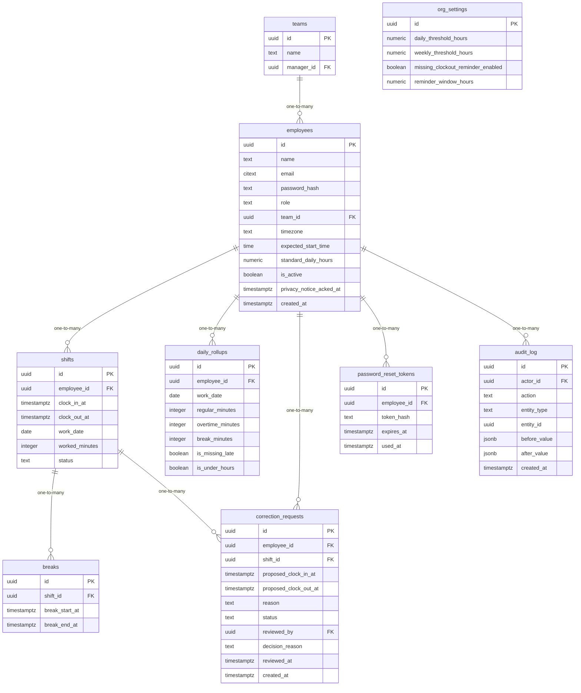

# Data Model

<!-- sdlc:auto:start entities -->
### teams

| Field | Type | PK | FK | Nullable |
|---|---|---|---|---|
| id | uuid | True | — | False |
| name | text | False | — | False |
| manager_id | uuid | False | employees.id | True |

### employees

| Field | Type | PK | FK | Nullable |
|---|---|---|---|---|
| id | uuid | True | — | False |
| name | text | False | — | False |
| email | citext | False | — | False |
| password_hash | text | False | — | True |
| role | text | False | — | False |
| team_id | uuid | False | teams.id | True |
| timezone | text | False | — | False |
| expected_start_time | time | False | — | True |
| standard_daily_hours | numeric | False | — | True |
| is_active | boolean | False | — | False |
| privacy_notice_acked_at | timestamptz | False | — | True |
| created_at | timestamptz | False | — | False |

### shifts

| Field | Type | PK | FK | Nullable |
|---|---|---|---|---|
| id | uuid | True | — | False |
| employee_id | uuid | False | employees.id | False |
| clock_in_at | timestamptz | False | — | False |
| clock_out_at | timestamptz | False | — | True |
| work_date | date | False | — | False |
| worked_minutes | integer | False | — | True |
| status | text | False | — | False |

### breaks

| Field | Type | PK | FK | Nullable |
|---|---|---|---|---|
| id | uuid | True | — | False |
| shift_id | uuid | False | shifts.id | False |
| break_start_at | timestamptz | False | — | False |
| break_end_at | timestamptz | False | — | True |

### daily_rollups

| Field | Type | PK | FK | Nullable |
|---|---|---|---|---|
| id | uuid | True | — | False |
| employee_id | uuid | False | employees.id | False |
| work_date | date | False | — | False |
| regular_minutes | integer | False | — | False |
| overtime_minutes | integer | False | — | False |
| break_minutes | integer | False | — | False |
| is_missing_late | boolean | False | — | False |
| is_under_hours | boolean | False | — | False |

### correction_requests

| Field | Type | PK | FK | Nullable |
|---|---|---|---|---|
| id | uuid | True | — | False |
| employee_id | uuid | False | employees.id | False |
| shift_id | uuid | False | shifts.id | True |
| proposed_clock_in_at | timestamptz | False | — | True |
| proposed_clock_out_at | timestamptz | False | — | True |
| reason | text | False | — | False |
| status | text | False | — | False |
| reviewed_by | uuid | False | employees.id | True |
| decision_reason | text | False | — | True |
| reviewed_at | timestamptz | False | — | True |
| created_at | timestamptz | False | — | False |

### org_settings

| Field | Type | PK | FK | Nullable |
|---|---|---|---|---|
| id | uuid | True | — | False |
| daily_threshold_hours | numeric | False | — | False |
| weekly_threshold_hours | numeric | False | — | False |
| missing_clockout_reminder_enabled | boolean | False | — | False |
| reminder_window_hours | numeric | False | — | True |

### password_reset_tokens

| Field | Type | PK | FK | Nullable |
|---|---|---|---|---|
| id | uuid | True | — | False |
| employee_id | uuid | False | employees.id | False |
| token_hash | text | False | — | False |
| expires_at | timestamptz | False | — | False |
| used_at | timestamptz | False | — | True |

### audit_log

| Field | Type | PK | FK | Nullable |
|---|---|---|---|---|
| id | uuid | True | — | False |
| actor_id | uuid | False | employees.id | True |
| action | text | False | — | False |
| entity_type | text | False | — | False |
| entity_id | uuid | False | — | True |
| before_value | jsonb | False | — | True |
| after_value | jsonb | False | — | True |
| created_at | timestamptz | False | — | False |
<!-- sdlc:auto:end entities -->

<!-- sdlc:auto:start relationships -->
| Source | Target | Type |
|---|---|---|
| teams | employees | one-to-many |
| employees | shifts | one-to-many |
| shifts | breaks | one-to-many |
| employees | daily_rollups | one-to-many |
| employees | correction_requests | one-to-many |
| shifts | correction_requests | one-to-many |
| employees | password_reset_tokens | one-to-many |
| employees | audit_log | one-to-many |
<!-- sdlc:auto:end relationships -->

<!-- sdlc:auto:start er-diagram -->

<!-- sdlc:auto:end er-diagram -->
