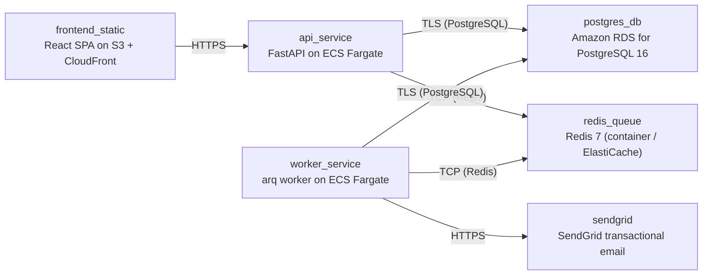

# Deployment Guide

> Maintained by QuorQ AI SDLC. Text between `sdlc:auto` markers is regenerated; anything outside them is yours and is kept.

<!-- sdlc:auto:start how-it-deploys -->
Pushes to `main` run `.github/workflows/deploy.yml`, which builds the API image (if there is a backend) and deploys the SPA to AWS Amplify. Commits touching only `docs/sdlc/**` don't deploy. Deployments can also be started from the platform's Deployment tab.
<!-- sdlc:auto:end how-it-deploys -->

<!-- sdlc:auto:start environments -->
| Name | Service | Runtime | Scaling | Environment |
|---|---|---|---|---|
| frontend_static | React SPA on S3 + CloudFront | Static build (CDN) | CDN-served, no instance scaling | dev |
| api_service | FastAPI on ECS Fargate | Python 3.12 container (uvicorn) | 1 task (low concurrency, <50 users) | dev |
| worker_service | arq worker on ECS Fargate | Python 3.12 container | 1 task | dev |
| postgres_db | Amazon RDS for PostgreSQL 16 | Managed PostgreSQL 16 | Single instance, encryption at rest (KMS), automated backups | dev |
| redis_queue | Redis 7 (container / ElastiCache) | redis:7-alpine | Single node | dev |
| sendgrid | SendGrid transactional email | SaaS API | Managed by provider | dev |
<!-- sdlc:auto:end environments -->

<!-- sdlc:auto:start live -->
_Not deployed yet._
<!-- sdlc:auto:end live -->

<!-- sdlc:auto:start topology -->

<!-- sdlc:auto:end topology -->
